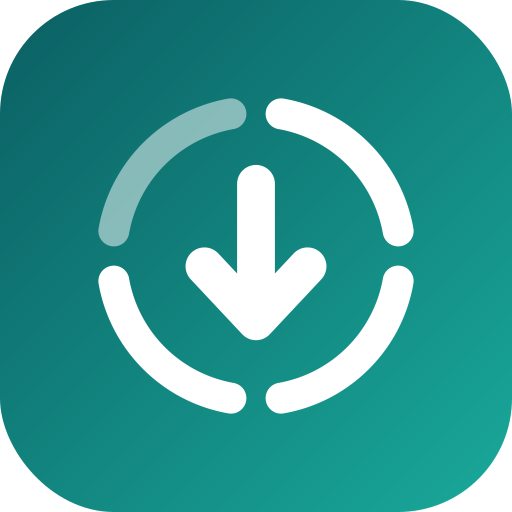

<p align="center">
  
</p>

<h1 align="center">Status Vault</h1>

<p align="center">
  A private, ad-free Android app to view, save and share WhatsApp statuses.<br/>
  Lightweight and open source.
</p>

<p align="center">
  <a href="https://github.com/C-VEDIYAPPAN/StatusVault/releases/latest"><b>Download the latest APK</b></a>
</p>

---

## Features

- **Browse** WhatsApp and WhatsApp Business statuses, plus everything you've saved
- **Save** one status or all of them in one tap, to your phone's gallery
- **Video player** with seek preview, double-tap to skip, speed control and mute
- **Repost** a status to WhatsApp, or share it to any app
- **Grab a photo** from any moment of a video
- **Unopened dot** and a **countdown** showing how long until a status expires
- **Auto-save** new statuses, optionally in the background
- **App lock** with fingerprint, face or screen lock
- **13 accent colours**, wallpaper colours (Android 12+), light and dark themes
- **Update alerts**: tells you when a new version is out, with a one-tap download

## Privacy

Nothing you view or save ever leaves your phone. There are no ads, no analytics and no accounts.

The app's only network use is checking this repository's
[latest release](https://github.com/C-VEDIYAPPAN/StatusVault/releases/latest) for updates.
You can switch it off in **Settings → Updates**. The app never installs anything itself;
Android's installer does, and it only accepts updates signed with the same key.

## Install

1. Download the APK from [Releases](https://github.com/C-VEDIYAPPAN/StatusVault/releases/latest) and open it on your phone.
2. Allow "Install unknown apps" if Android asks.
3. Open the app, tap **Grant access**, then **Use this folder → Allow**.

Requires **Android 8.0 or newer**. Statuses appear after you've viewed them in WhatsApp,
and WhatsApp removes them after 24 hours.

## How it works

Since Android 11, apps can't read another app's files directly. Status Vault uses Android's
folder picker (Storage Access Framework) to get read access to WhatsApp's `.Statuses` folder
once, with your permission. Saved files go into `Pictures/StatusVault` and `Movies/StatusVault`
through MediaStore, so no storage permission is needed on Android 10+.

## Build from source

The app is plain Java on the Android framework, with no third-party libraries.

**Android Studio:** open the project and choose *Build → Build APK(s)*.

**Command line:**

```bash
./gradlew assembleRelease
```

Every push to `main` is built by GitHub Actions and published to
[Releases](https://github.com/C-VEDIYAPPAN/StatusVault/releases).

## Contributing

Issues and pull requests are welcome. Please keep the app free of trackers, ads and
network access.

## License

Copyright © 2026 Vediyappan

Licensed under the [GNU General Public License v3.0](LICENSE). You may use, change and share
this code; if you publish a modified version, you must share its source under the same licence.

## Disclaimer

Status Vault is an independent project and is not affiliated with, endorsed by, or connected to
WhatsApp or Meta. Only save statuses you have permission to keep.
